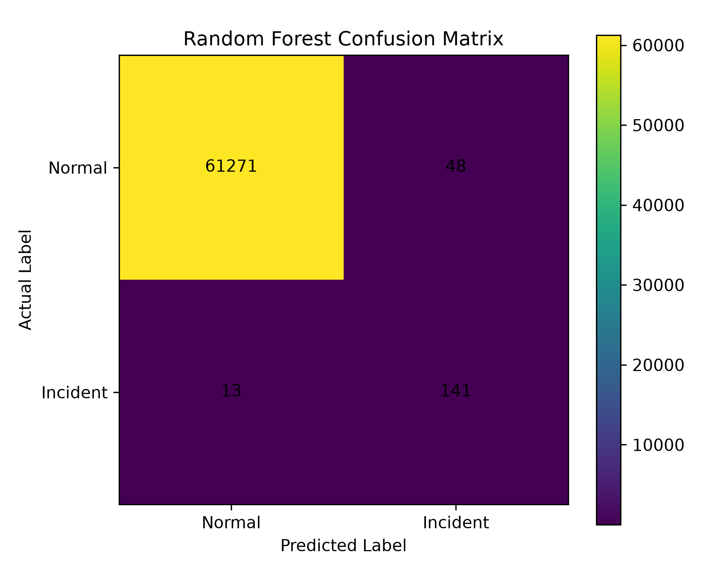
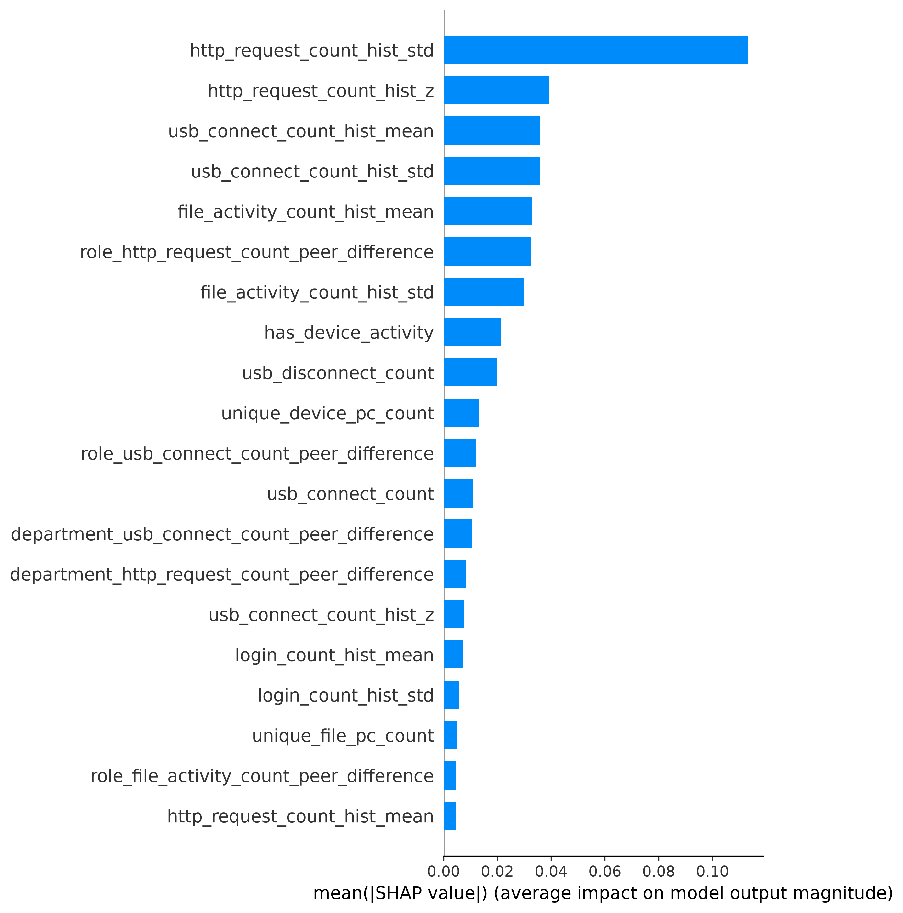
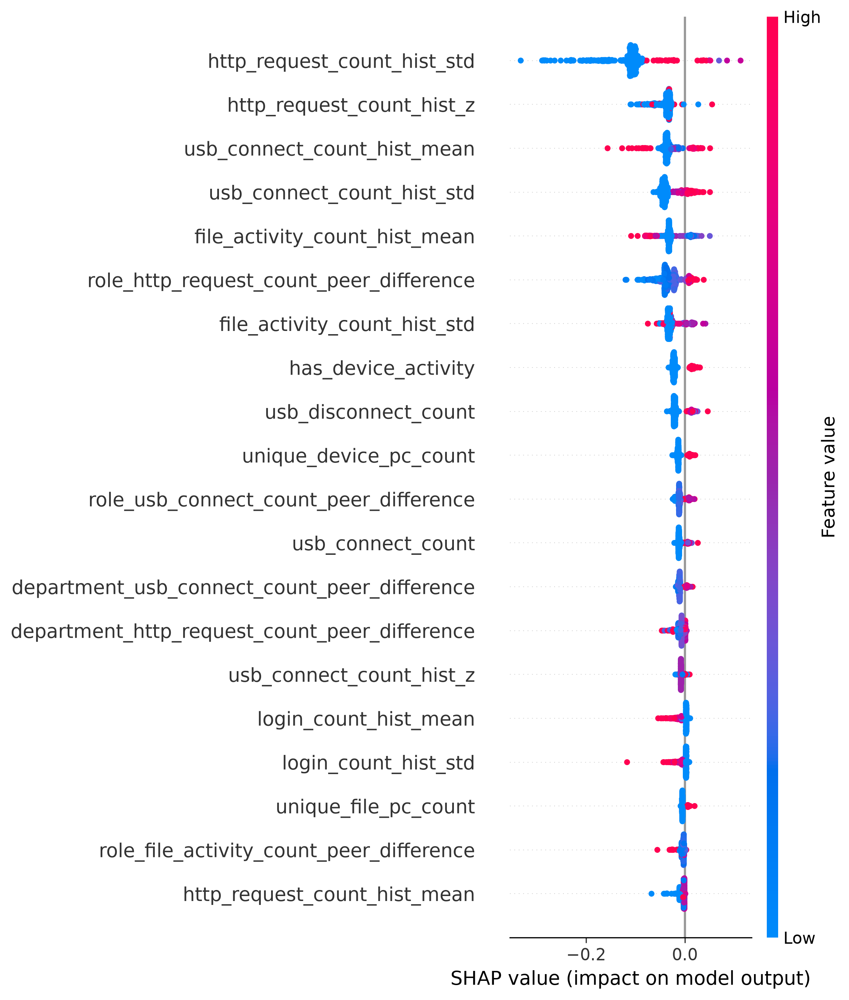
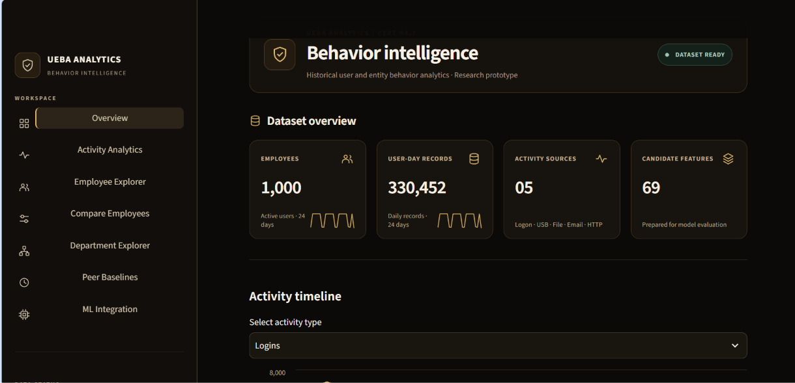
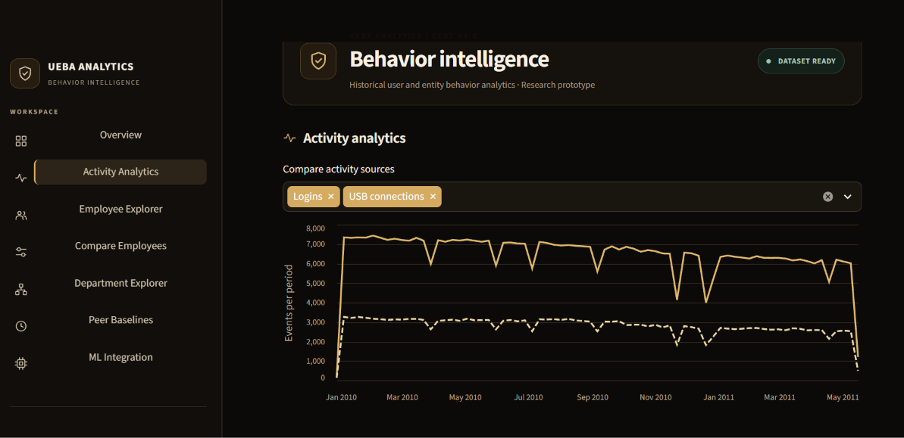
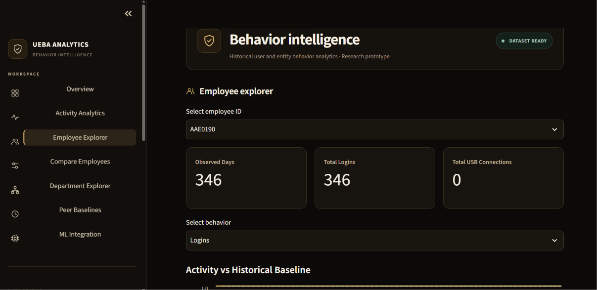
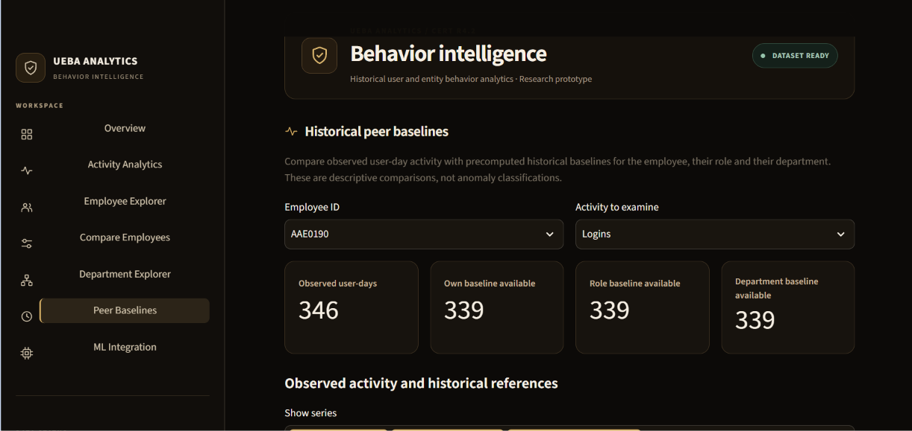
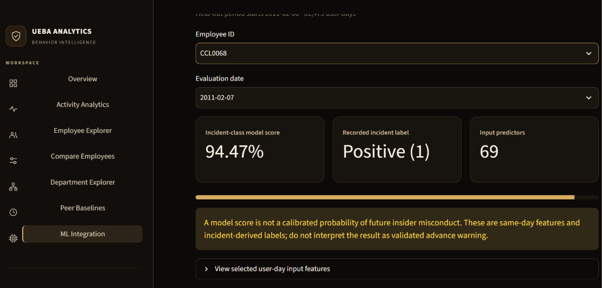

# UEBA Insider Threat Detection

**Big Data-Based User Behavior Anomaly Detection for Insider Threat Detection Using the CERT Dataset**

An end-to-end User and Entity Behavior Analytics (UEBA) prototype built using Apache Spark, Python, Random Forest, SHAP and Streamlit.

**Dataset:** CERT Insider Threat Test Dataset r4.2  
**Project:** MSc Data Science and Bio AI — Big Data Capstone  
**Team:** Sravana Nambiar (253212) and Ayana Santhosh Khan (253217)

## Project Overview

Insider threats are difficult to identify because suspicious activities can occur through legitimate employee accounts. An unusual login, file operation or USB connection does not necessarily indicate malicious behaviour when considered on its own.

This project brings together five types of employee activity logs to study behavioural patterns across users and departments. Apache Spark is used for processing the activity data, while historical user and peer-group baselines provide additional context. A Random Forest classifier identifies employee-days associated with known CERT incident records, and SHAP helps explain the model's results.

The final system is presented through an interactive Streamlit dashboard that combines behavioural analytics, employee exploration and machine-learning results.

## Dataset

The project uses the synthetic CERT r4.2 Insider Threat Test Dataset.

Five activity sources are processed:

- Logon and logoff activities
- Device and removable-media usage
- File activity
- Email activity
- HTTP/web-browsing activity

Monthly LDAP snapshots provide organisational information such as employee roles and departments. CERT incident answer files are used for supervised ground-truth labeling.

### Processed dataset summary

| Description | Value |
|---|---:|
| Employees | 1,000 |
| Employee-day records | 330,452 |
| Numerical ML predictors | 69 |
| Incident-positive employee-days | 966 |
| Training records | 268,979 |
| Testing records | 61,473 |
| Positive test records | 154 |

The dataset is synthetic and the results should not be interpreted as validated performance in a real organisational environment.

## Technologies Used

| Component | Technology |
|---|---|
| Programming | Python |
| Big Data processing | Apache Spark / PySpark |
| Data preparation | Pandas, PyArrow, Parquet |
| Machine learning | Scikit-learn, Random Forest |
| Explainability | SHAP |
| Visualisation | Streamlit, Matplotlib |
| Version control | Git and GitHub |
| Dataset | CERT r4.2 |

## Project Workflow

1. **Data ingestion:** Read and process the five CERT activity log sources.
2. **Feature engineering:** Aggregate activity into employee-day records.
3. **Data integration:** Combine activity sources and enrich records with LDAP information.
4. **Historical baselines:** Calculate rolling user behaviour statistics using previous observations.
5. **Peer comparisons:** Compare employee activity with historical department and role patterns.
6. **Ground-truth labeling:** Match CERT incident observables with employee-day records.
7. **Machine learning:** Train and evaluate a Random Forest classifier using a chronological split.
8. **Explainability:** Examine feature contributions using SHAP.
9. **Dashboard integration:** Explore the processed dataset, model evaluation and individual predictions through Streamlit.

## Feature Engineering

The processing pipeline produces behavioural indicators from logon, file, device, email and HTTP activity.

Historical features use up to 30 previous observed employee-days, with a minimum of seven observations. Department- and role-level peer comparisons use eligible previous group-days rather than current-day peer averages.

The final feature handoff separates numeric model predictors from employee identifiers and organisational context. Employee IDs and dates are used for alignment and chronological splitting but are not included as Random Forest predictors.

## Random Forest Model and Evaluation

The supervised model uses 69 numeric behavioural predictors and a chronological train/test split, with testing beginning on 6 February 2011.

The Random Forest uses 150 trees, maximum depth 16, minimum leaf size 3, and balanced subsample class weighting. Missing values are handled through median imputation within the scikit-learn pipeline.

### Preliminary model results

| Metric | Result |
|---|---:|
| Accuracy | 0.9990 |
| Precision | 0.7460 |
| Recall | 0.9156 |
| F1-score | 0.8222 |
| ROC-AUC | 0.9998 |
| Average Precision (AP) | 0.9392 |

These are preliminary incident-day classification results. The model correctly identified 141 of 154 incident-positive test observations, with 13 false negatives and 48 false positives.

**Important limitation:** The model uses completed employee-day activity to classify incidents recorded on those days. These results do not establish an ability to predict insider activity before it occurs. Additional validation is needed for incident-label provenance, repeated employee and scenario patterns, and generalisation.

### Confusion Matrix



## SHAP Explainability

SHAP is used to examine the behavioural features contributing to the Random Forest's predictions. Historical HTTP variability, USB activity and historical file behaviour are among the influential features.

### SHAP Feature Importance



### SHAP Summary



Feature importance indicates how the model uses available information. It should not be treated as proof that an employee has carried out malicious activity.

## Apache Spark Performance Benchmarking

The project includes 27 saved benchmark runs to evaluate local Spark processing performance.

File and email workloads were tested using one, two and four CPU cores, with three runs per configuration. HTTP input-size scaling was evaluated using 256 MiB, 512 MiB and 1,024 MiB subsets.

### CPU scaling

| Dataset | 1 Core | 2 Cores | 4 Cores | Four-Core Speedup |
|---|---:|---:|---:|---:|
| File (184 MiB) | 10.21 s | 8.67 s | 7.61 s | 1.34× |
| Email (1,299 MiB) | 35.68 s | 23.74 s | 18.12 s | 1.97× |

### HTTP input-size scaling

| Input Size | Events | Mean Runtime | Throughput |
|---|---:|---:|---:|
| 256 MiB | 525,559 | 8.39 s | 30.51 MiB/s |
| 512 MiB | 1,051,198 | 9.83 s | 52.06 MiB/s |
| 1,024 MiB | 2,102,687 | 13.26 s | 77.24 MiB/s |

The benchmarks show improved local processing performance with additional CPU cores and larger HTTP input sizes. They do not represent multi-node cluster performance.

## Integrated Streamlit Dashboard

The Streamlit application brings together the engineering, behavioural analytics and machine-learning components through seven main sections.

1. **Overview:** Dataset summary and activity trends.
2. **Activity Analytics:** Logon, email, file, HTTP and device activity exploration.
3. **Employee Explorer:** Individual employee behaviour over time.
4. **Compare Employees:** Side-by-side employee activity comparisons.
5. **Department Explorer:** Department-level activity patterns.
6. **Peer Baselines:** Historical behaviour compared with role and department peer groups.
7. **ML Integration:** Random Forest evaluation, confusion matrix, SHAP and interactive Risk Explorer.

## Dashboard Screenshots

### Overview


### Activity Analytics


### Employee Explorer


### Historical Peer Baselines


### ML Risk Explorer


## Running the Dashboard Locally

### 1. Clone the Repository

```bash
git clone https://github.com/ayanasanthoshkhan/UEBA-Insider-Threat-Detection.git
cd UEBA-Insider-Threat-Detection
```

### 2. Install Dependencies

Use a compatible Python environment.

```bash
python -m pip install -r requirements.txt
```

### 3. Prepare the Local Data Files

The main application requires the processed feature files, metadata, feature manifest, labeled dataset and trained Random Forest model.

Suggested directory structure:

```text
UEBA_Capstone/
├── data/
│   └── processed/
│       ├── ml_handoff/
│       │   ├── ml_candidate_features.parquet
│       │   ├── ml_context_metadata.parquet
│       │   └── feature_manifest.json
│       └── ueba_labeled_dataset.parquet
└── models/
    └── ueba_random_forest.joblib
```

These files are not included in the GitHub repository. The original CERT r4.2 data must be obtained separately and the preprocessing and training stages must be performed to reproduce them.

### 4. Configure the Data Directory

In Windows PowerShell, set `UEBA_DATA_ROOT` to the parent directory containing the `data` and `models` folders.

```powershell
$env:UEBA_DATA_ROOT = "D:\UEBA_Capstone"
```

Replace the path with the location on your computer.

### 5. Launch the Integrated Dashboard

Run the command from the repository root:

```powershell
python -m streamlit run dashboard/app.py
```

Open the local Streamlit URL shown in your terminal, normally `http://localhost:8501`.

**Note:** The older root-level `app.py` is a separate ML application. The complete integrated dashboard is `dashboard/app.py`.

## Repository Structure

```text
UEBA-Insider-Threat-Detection/
├── src/
│   ├── ingestion/
│   ├── features/
│   ├── benchmarks/
│   ├── labels/
│   ├── models/
│   └── explainability/
├── dashboard/
│   └── app.py
├── results/
│   ├── model_metrics.json
│   ├── confusion_matrix.png
│   ├── feature_importance.csv
│   └── shap/
├── docs/
│   └── screenshots/
├── app.py
├── requirements.txt
└── README.md
```

The `docs/screenshots` directory is intended for final dashboard screenshots.

## Team Contributions

### Ayana Santhosh Khan (253217) — Big Data Engineering and Dashboard Integration

- Apache Spark activity processing and feature engineering.
- Integration of logon, device, file, email and HTTP features.
- LDAP enrichment and historical user and peer-group baselines.
- Feature validation and ML handoff preparation.
- Spark performance benchmarking.
- Integrated Streamlit dashboard development and ML component integration.

### Sravana Nambiar (253212) — Machine Learning and Explainability

- CERT incident parsing, labeling and event verification.
- Ground-truth employee-day label construction.
- Random Forest model training and evaluation.
- Confusion matrix and feature-importance analysis.
- SHAP explainability.
- ML dashboard components and integration testing.

## Limitations and Future Work

- CERT r4.2 represents synthetic organisational behaviour.
- Positive and negative labels depend on the available incident answer material.
- The chronological split alone does not guarantee generalisation to unseen insiders or scenarios.
- The current model classifies completed employee-days rather than predicting future incidents.
- Additional investigation of unusually high model performance and possible evaluation leakage is required.
- Isolation Forest comparison and cloud deployment were proposed extensions and are not presented as completed components.
- The project is a research prototype and should not be used to make automated employment or disciplinary decisions.

## Project Status

The local prototype integrates the PySpark feature pipeline, supervised Random Forest classification, SHAP explainability and an interactive Streamlit dashboard. The model evaluation remains preliminary and requires further scientific validation before broader claims can be made.

## Dataset and References

- CERT Insider Threat Test Dataset — Carnegie Mellon University / Software Engineering Institute.
- Garchery, M., & Granitzer, M. (2020). *ADSAGE: Anomaly detection in sequences of attributed graph edges applied to insider threat detection at fine-grained level*. https://doi.org/10.48550/arXiv.2007.06985
- Cai, X., et al. (2024). *LAN: Learning adaptive neighbors for real-time insider threat detection*. https://doi.org/10.48550/arXiv.2403.09209
- Zhou, J., et al. (2024). *Lateral movement detection via time-aware subgraph classification on authentication logs*. https://doi.org/10.48550/arXiv.2411.10279
